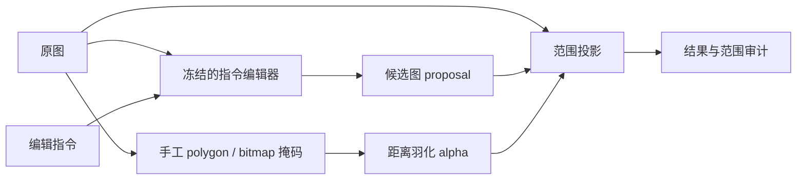

# make-your-AIGC-clear

把指令编辑器生成的候选图（proposal）限制到手工标注的范围内。冻结的编辑器负责语义和形体重组，材质掩码决定允许改动的位置，确定性的投影在保存前精确恢复范围外的原始像素。



## 五步运行合成示例

需要 Python 3.9+，在仓库根目录运行。以下示例用 Pillow 绘制原图和候选图，无需 GPU、下载模型权重或 API 密钥。

```powershell
pip install -e .

python examples/make_demo.py --output-dir demo_data

aigc-clear mask --input demo_data/source.png --config demo_data/scope.json --output-dir demo_data/masks

aigc-clear project --input demo_data/source.png --proposal demo_data/proposal.png --mask demo_data/masks/mask.png --alpha demo_data/masks/alpha.png --output demo_data/result.png --report demo_data/report.json

aigc-clear audit --reference demo_data/source.png --image demo_data/result.png --mask demo_data/masks/mask.png

aigc-clear compare --images demo_data/source.png demo_data/result.png --output demo_data/comparison.png
```

`result.png` 是投影后的图像，`comparison.png` 用于并排查看原图与结果，审计会检查掩码外的像素差异。所有写文件命令默认拒绝覆盖已有文件；需要重新生成时加 `--overwrite`。

`run` 可以合并掩码生成、投影、审计与并排预览：

```powershell
aigc-clear run --input demo_data/source.png --config demo_data/scope.json --proposal demo_data/proposal.png --output-dir demo_data/run
```

并排图只用于查看，审计读取保存后的原尺寸 PNG。中文标签可以用 `compare --labels` 设置，并通过 `--font` 指定支持中文的字体，例如 Windows 的微软雅黑：

```powershell
aigc-clear compare --images demo_data/source.png demo_data/result.png --labels "原图" "范围投影结果" --font C:/Windows/Fonts/msyh.ttc --output demo_data/comparison_zh.png
```

## 用在自己的图像上

先按当前图像的尺寸标注 polygon 或 bitmap 材质掩码，再准备与原图同尺寸的候选图；透明图像需先显式铺底。把示例命令中的文件路径替换为自己的文件即可。`scope.json` 的 `coordinate_size` 必须匹配原图尺寸；掩码绑定像素坐标，换图后需要重新标注。

配置中的 `allow`、`protect` 与可选 `base_mask` 定义完整允许域，`active_rects` 选择本轮编辑区域。`mask.png` 是去除保护区后的完整允许域，`active_mask.png` 是它与本轮区域的交集。羽化按本轮有效区域计算，审计按完整允许域检查。

已有候选图可以直接调用 `project`。如需从编辑指令生成候选图，可以安装下列可选后端。

| 后端 | 安装 | 用途 |
| --- | --- | --- |
| 已有 proposal | `pip install -e .` | 使用任意来源的同尺寸候选图，运行确定性的范围投影 |
| OpenAI | `pip install -e '.[openai]'` | 通过 OpenAI SDK 的 `images.edit` 生成候选图，默认模型为 `gpt-image-2` |
| Klein | `pip install -e '.[klein]'` | 使用官方模型 revision 进行冻结推理，需要 Python 3.10+，已在 Python 3.12 测试 |

设置环境变量 `OPENAI_API_KEY` 后，可运行 OpenAI 后端：

```powershell
aigc-clear propose --backend openai --input input.png --prompt-file prompts/hair.txt --output proposal.png --model gpt-image-2
```

Klein 后端的入口相同：

```powershell
aigc-clear propose --backend klein --input input.png --prompt-file prompts/hair.txt --output proposal.png
```

`--crop L T R B` 指定编辑裁剪范围，坐标按左、上、右、下的顺序传入，右边与下边不包含在范围内。编辑结果按原坐标回填，输出仍与原图同尺寸，裁剪外使用原图像素。模型返回尺寸不一致时，命令保留 `.raw.png` 并停止，不会自动缩放候选图。

Klein 输入宽高必须为 16 的倍数，后端保留原生尺寸。默认模型是 `black-forest-labs/FLUX.2-klein-4B`，revision 固定为 `e7b7dc27f91deacad38e78976d1f2b499d76a294`，种子为 2026，推理步数为 4。默认使用 CUDA，也可指定 `--device cpu`。更多选项见 `aigc-clear propose --help`。

也可以让 `run` 先调用编辑器，再执行范围投影与审计：

```powershell
aigc-clear run --input input.png --config scope.json --backend openai --prompt-file prompts/hair.txt --output-dir output
```

## 投影公式

设原图为 $x$，候选图为 $r$，完整允许域的二值掩码为 $M$，本轮有效区域的掩码为 $A$，且 $A\le M$。有效像素到 $A$ 边界的距离为 $d(p)$，羽化宽度为 $f$。对 $f>0$，

$$
\alpha(p)=
\begin{cases}
\operatorname{clip}\!\left(\dfrac{d(p)}{f},0,1\right), & A(p)=1,\\
0, & A(p)=0.
\end{cases}
$$

对每个颜色通道，计算

$$
y(p)=\operatorname{round}\!\left[
\operatorname{clip}\bigl(x(p)+\alpha(p)(r(p)-x(p)),0,255\bigr)
\right].
$$

`alpha.png` 把权重量化为 8 位灰度，投影时读取的实际权重为灰度值除以 255。`feather_px=0` 使有效区域的权重全部为 1；省略 `project --alpha` 时，直接按二值掩码硬替换。

最后令所有 $M(p)=0$ 的像素重新等于 $x(p)$。输出使用 PNG，范围外的像素可以逐值核对，边界内的改变量由距离羽化控制。完整定义与审计方式见 [算法说明](docs/algorithm.md)。

## 复现范围

原始成功路径中的候选图由内置 `imagegen` 生成，其模型 checkpoint 与随机种子没有公开。本仓库可复现给定原图、候选图和掩码后的投影过程；可选编辑后端用于生成新的候选图。不同编辑器、版本和采样过程会改变候选图，代码不能从文本指令还原原始生成过程。

采用公开 Klein 模型的代理实验使用原生 512 裁剪：`sidehair2` 与 `sidehair3` 通过了视觉检查，`sleeves` 的结果不稳定。这些检查记录代理路径的表现，不能视为最优结果的复现。范围控制只保证允许改动的位置，审美效果仍由候选图、掩码与编辑指令共同决定。

仓库只提供自造合成示例，不附私人原图、闭源原始输出或模型权重。当前成功路径使用人工材质掩码，没有使用 CNN 自动锚点或显式 Itô / MSE 理论。

## 开发验证

```powershell
python -m unittest discover -v
```

52 项测试覆盖像素保护、掩码边界、文件写入和后端接口。后端测试使用 mock；完整示例可按前面的命令运行。

[GitHub Actions 配置](docs/github-actions.yml.example) 包含 Windows / Linux 与 Python 3.9 / 3.12 测试矩阵。将其复制到 `.github/workflows/ci.yml` 即可启用；通过 token 推送工作流文件需要对应的工作流写入权限。
